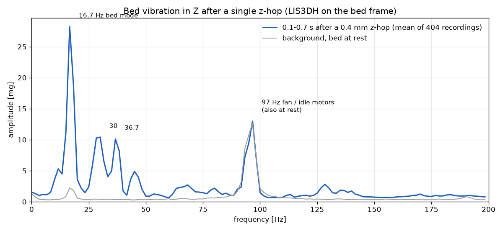
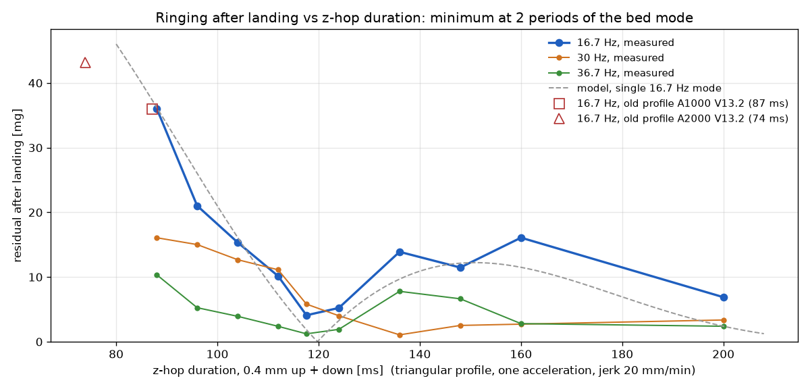
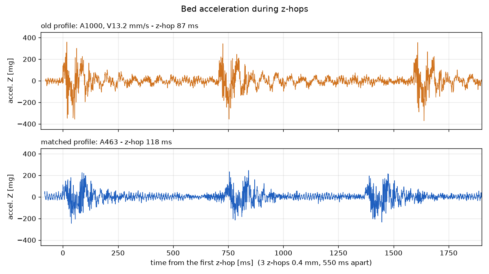
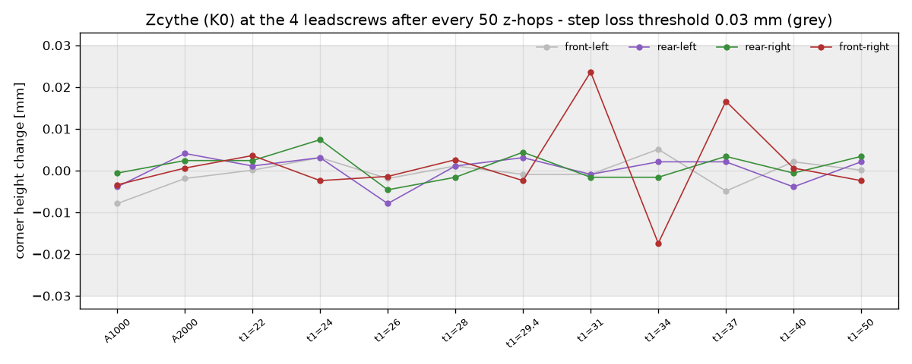

# Z drive diagnostics with Zcythe (K0)

How fast can the bed move in Z without losing steps, and what z-hop leaves the least vibration behind?
This page describes a measurement method that answers both questions **on the printer itself, with the bed probe
that is already there** – Zcythe (K0). An accelerometer is optional and only needed for the vibration part.

Tested on: Voron-style CoreXY, 400 × 400 bed moving in Z, 4 independent Z motors with Tr8x2 leadscrews
(self-locking), external A4988 drivers, Duet 2 WiFi, RRF 3.6.1. Trident convention: **Z+ = bed down**.

## Why bother

- A z-hop is the most frequent Z move of a print – thousands per hour. Each one is a short, violent move:
  start, reversal, landing. A lost step on one of four Z motors tilts the bed by a few hundredths of a mm and the
  print continues with a wrong first-layer geometry – nobody notices until the part is off.
- The Z limits in `config.g` (`M201`, `M203`, `M566` for Z) are usually guessed. Too low costs time on every
  layer; too high costs steps.
- Bed **up** and bed **down** are not the same move: gravity, the self-locking thread and the motor current all
  work differently in each direction. A single limit is always set by the weaker direction.
- After landing, the bed rings. The nozzle is already printing during that ringing.

## The idea: K0 as a step-loss detector

Zcythe touches the bed at the 4 leadscrew points before and after a series of Z moves (`ztest_chk.g`, one slow
dive per corner, no motor correction). If no step was lost, the 4 heights are the same. If one motor lost steps,
its corner moved.

| | |
|---|---|
| Repeatability of a corner (no motion between checks) | 0.005–0.007 mm |
| Step-loss threshold | 0.03 mm per corner (corrected for slow mechanical drift per metre of travel) |
| One full step of a Z motor (Tr8x2, 200 steps/rev) | 0.010 mm |
| Time for one check | ~25 s |

So **a single lost full step on any of the four motors is visible**, separately for each corner, without encoders,
without extra sensors and without printing anything.

## Tools

| File | What |
|---|---|
| `sys/ztest_chk.g` | K0 at the 4 leadscrew points, one dive each → `global.ztH[4]` |
| `sys/ztest_lvl.g` | Levelling (G30 … S4) without operator windows, repeated until deviation ≤ 0.02 mm |
| `sys/zdir_step.g` | N up/down cycles, **each direction with its own speed / acceleration / jerk** |
| `sys/zhop4_step.g` | N z-hops split into 4 phases (bed down accel / brake, bed up accel / brake), each with its own acceleration; optional LIS3DH recording |
| `tools/zdir_sweep.py` | Ladder test of the Z limits per direction (jerk, acceleration, speed), confirmation runs, final validation |
| `tools/zhop4_sweep.py` | 4-phase z-hop ladders, junction check, and `--etap res`: z-hop duration vs bed resonance |
| `tools/acc_z.py`, `acc_spec.py`, `zres_an.py`, `zres_plots.py`, `zdiag_figs_en.py` | Accelerometer analysis: peaks, settle time, spectrum, residual per band, figures |
| `../stl/z-drive/` | Test print and holders – see [STL](../stl/z-drive/README.md) |

All scripts: run in the background, progress on PanelDue (DWC can stay closed), CSV + log per run, a stop file
(`data/zdir_STOP`) ends a run cleanly, the config Z limits are restored at the end. **They move the machine – empty
bed, operator at the printer.**

### How a ladder works

1. Level (`ztest_lvl.g`), two K0 checks without motion → repeatability (run stops if > 0.015 mm).
2. For each step of the ladder: 3 trial cycles, then a series (e.g. 100 z-hops of 0.4 mm), then a K0 check.
   Corner change minus expected drift > 0.03 mm → **fail**; a probe that does not trigger → stall, re-home, re-level.
3. Halve the interval between the last good and the first failed step once, confirm the limit with 3× more cycles.
4. Working value = 0.5 × limit. Final validation: 300 z-hops of 0.4 mm + 30 strokes of 2 mm (or 20 mm).

## Results on the test machine

### Limits per direction (bed direction, K0 step-loss test)

| Jerk Z [mm/min] | bed **down** acceleration limit | bed **up** acceleration limit |
|---|---|---|
| 330–360 | 350 mm/s² | 175 mm/s² |
| 60 | ≥ 2000 | 925 |
| 20 | ≥ 2000 | ≥ 2000 |

Jerk limits (at low acceleration): down 720, up 660 mm/min. Speed: down 18.8 mm/s, up ≥ 40 mm/s.
Validation of the working set: 300 × 0.4 mm max corner change 0.007 mm, 30 × 20 mm 0.006 mm.

**Jerk, not acceleration, was the step-killer.** Lowering Z jerk from 330 to 20 mm/min raised the safe
acceleration more than 10×. With the RRF planner a "jerk" is an instantaneous speed step – for a heavy bed on a
fine-pitch screw it is a hammer blow.

### Junctions are joined

A z-hop split into 4 moves with different `M201 Z` before each move (no `M400` between them) runs without stops
at the junctions: measured cycle time = "joined" model within 1 %, the "stop at junction" model is 25–35 % slower.
So each phase of a z-hop can have its own acceleration in RRF.

### Bed resonance (LIS3DH on the bed frame)



The bed rings at **16.7 Hz** (plus 30 and 36.7 Hz) after every z-hop. A 0.4 mm z-hop with the old profile
(A1000, 13.2 mm/s) takes 87 ms – about 1.5 periods, the worst case.

A short z-hop is four acceleration pulses (+ − − +). For a single mode with period P the residual vibration
is zero when one pulse lasts P/2, i.e. **the whole z-hop lasts 2 P**. Measured:



| z-hop 0.4 mm | acceleration | 16.7 Hz after landing | peak during the hop |
|---|---|---|---|
| 74 ms (old A2000) | 2000 | 43 mg | ~400 mg |
| 87 ms (old A1000) | 1000 | 36 mg | ~360 mg |
| **118 ms** | **463** | **4 mg** | **~245 mg** |
| 124 ms | 416 | 5 mg | ~260 mg |
| 148 ms | 292 | 11 mg | ~190 mg |

At 118–124 ms all bands from 11 to 45 Hz drop together (the zeros for 30 and 36.7 Hz lie close by).
**Shorter is not quieter** – the old, faster z-hop left 8× more ringing.



Every point above was also a step-loss test (50 z-hops + K0 check) – no step lost anywhere:



### Rule for `config.g`

With one acceleration for the whole z-hop (triangular profile, speed limit not reached):

```
z-hop duration = 4 · t1,   t1 = P / 2,   A = s / t1²
```

16.7 Hz → t1 ≈ 30 ms → **A ≈ s / 0.0009**: 0.3 mm → 330 mm/s², 0.4 mm → 440 mm/s². The peak speed is
s / t1 (10 mm/s for 0.3 mm), so `M203 Z` must allow it. Validated on the test machine for 0.3 mm:
A330 → 16.7 Hz residual 4.2 mg vs 23.4 mg with A1000, no step loss. Current config: `M201 Z330`, `M566 Z20`, `M203 Z600`.

**Check how your slicer lifts.** OrcaSlicer *Auto Lift* / *Slope Lift* raises the nozzle during the travel
move and lowers it with a separate Z-only move. The landing alone is two pulses (+ −); its residual is zero when
it lasts **2 P** (≈ 120 ms → A ≈ 85–100 mm/s² for 0.3 mm). The figures above are for a vertical
(*Normal Lift*) z-hop. Measure your own case – the test print `stl/z-drive/zhop_islands_test.stl` with z-hop on
*All Surfaces* gives ~2400 z-hops in under an hour.

Heavy prints lower the bed frequency (f ∝ 1/√m): with a ~5 kg moving bed, +0.5 kg moves the optimum by ~5 %;
the valley is wide enough for that. Pick t1 slightly longer than the empty-bed optimum.

## Advantages of this diagnostics

- **No extra hardware for step loss** – Zcythe is already on the toolhead for print start-up; the same probe
  becomes a 4-channel step-loss detector with 0.005 mm repeatability.
- **Per corner, per motor** – a weak corner (tight spot on one screw, a loose coupler, one hot driver) shows up as
  one line in the CSV, not as "the bed is a bit off".
- **Per direction** – bed up and bed down are measured separately; the config can be set by real limits instead of
  the worst guess.
- **Measures what matters for the print** – the moves are the real z-hops and layer changes, with the real
  mass, screws, drivers and firmware planner, not a model.
- **Automatic and repeatable** – ladders, halving, confirmation, re-home after a stall, drift correction, all logged;
  a run of 12 settings takes ~12 minutes. Repeat after any mechanical change and compare CSVs.
- **Safe to run unattended for a while** – runs stop on the first unexplained result; config limits are restored;
  progress and errors on PanelDue.
- **Vibration is optional but cheap** – one LIS3DH on the bed frame turns the same runs into a resonance map and gives
  the z-hop duration that cancels the ringing. A firmware feature RRF does not offer for Z (input shaping is XY only).
- **Faster and gentler** – on the test machine Z jerk 20 + matched acceleration replaced jerk 330 + low
  acceleration: no step loss up to the tested 2000 mm/s², lower peaks on the mechanics, 6–8× less ringing after
  landing, at the cost of ~35 ms per z-hop.

## Notes and pitfalls

- **WiFi + accelerometer (Duet 2 WiFi):** the LIS3DH shares SPI with the WiFi module. Recording (`M956`) while
  HTTP requests arrive hung the WiFi module twice (printer unreachable until power cycle). Keep the HTTP channel
  silent for a few seconds during a recording (`voron_api.run(..., wait0=5)`) and record as few times as needed
  (one recording with 3 z-hops per setting instead of one per z-hop).
- `M955` must be re-issued after every power-on.
- The first samples of every `M956` recording are an artefact (0.2–0.4 g) – skipped in the analysis.
- In `M98` calls do not use `M`, `G`, `E` (and `T`, `P`) as parameter letters.
- RRF takes `M201/M203/M566` when a move is queued – that is what makes per-phase limits possible without `M400`.

## STL

See [stl/z-drive](../stl/z-drive/README.md): test print (ready), accelerometer holder and cable clip (placeholders).
